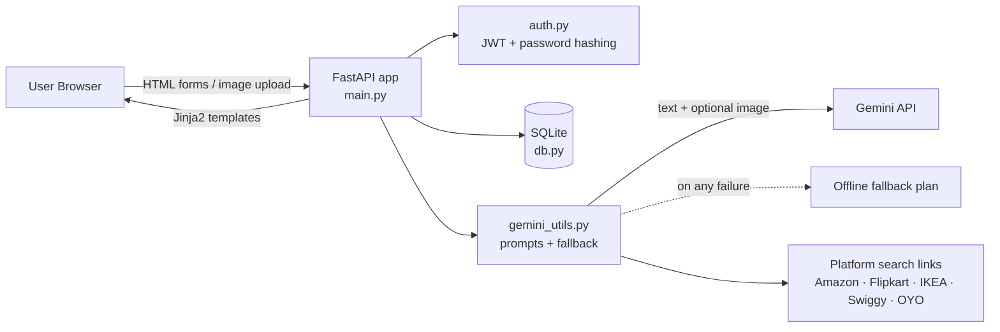
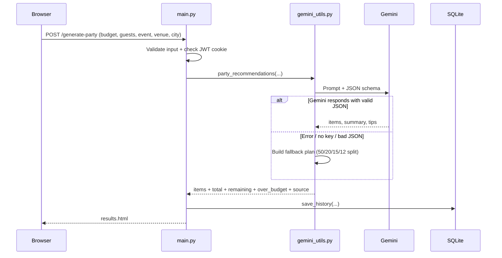

# Phase 2 — Architecture & Technology Stack

> Phase 2 of 8 · [Index](README.md) · ← [Phase 1](Phase-1-Project-Overview.md) · Next → [Phase 3: Gemini AI Setup](Phase-3-Gemini-AI-Setup.md)

## 1. Objective of this phase
Choose the technologies and design a modular architecture that connects the browser, the backend, the database and the Gemini model.

## 2. Technology stack (as implemented in the source code)
| Layer | Technology | Role |
|---|---|---|
| Backend framework | **FastAPI** + Uvicorn | Routing, form handling, auth dependencies |
| Templating / UI | **Jinja2**, HTML, CSS, a little JavaScript | Server-rendered pages |
| AI | **Google Gemini** via the `google-genai` SDK (default model `gemini-2.5-flash`, configurable with `GEMINI_MODEL`) | Budget reasoning, structured recommendations, image understanding |
| Database | **SQLite** (`pocketsmart.db`) | Users and recommendation history |
| Auth | **PyJWT** (HS256) + PBKDF2-SHA256 password hashing | Sessions and secure credentials |
| Config | `python-dotenv` + `.env` | API key and secret key |

> **Note on the original project write-up:** the Word walkthrough mentions Flask and "Gemini 1.5 Flash Pro". The delivered code uses **FastAPI** and defaults to **`gemini-2.5-flash`**. This documentation follows the code. The model can be changed with one environment variable.

## 3. High-level architecture


## 4. Component responsibilities
| Component | File | Responsibility |
|---|---|---|
| Web layer | `main.py` | All routes, input validation, template rendering |
| AI engine | `gemini_utils.py` | Prompt building, Gemini call, JSON parsing, totals, links, fallback |
| Authentication | `auth.py` | Hash/verify passwords, create/validate JWT, current-user dependency |
| Persistence | `db.py` | Create tables, users, save/list/get history |
| Presentation | `*.html`, `style.css` | Pages and styling |

## 5. Request lifecycle (example: Party Planner)


## 6. Key design decisions
1. **Strict JSON contract.** The prompt demands one fixed JSON shape and Gemini is called with `response_mime_type="application/json"`, so the UI can render results reliably.
2. **Graceful degradation.** Any AI failure returns a deterministic fallback plan, labelled "Fallback (offline defaults)".
3. **Safe "simulated" platform links.** Product links are search URLs built from templates, so no scraping is needed.
4. **Stateless auth.** JWT in an HTTP-only cookie (or `Authorization: Bearer` for API clients).
5. **Single-file modules.** Small, readable modules that are easy to extend with new planners.

## 7. Database design
```
users(id PK, username UNIQUE, email, password)
history(id PK, user_id, category, budget, inputs JSON, result JSON, created TIMESTAMP)
```

---
## 8. Output of Phase 2
**Result:** the architecture diagram, request lifecycle and data model above, plus the final technology stack.
