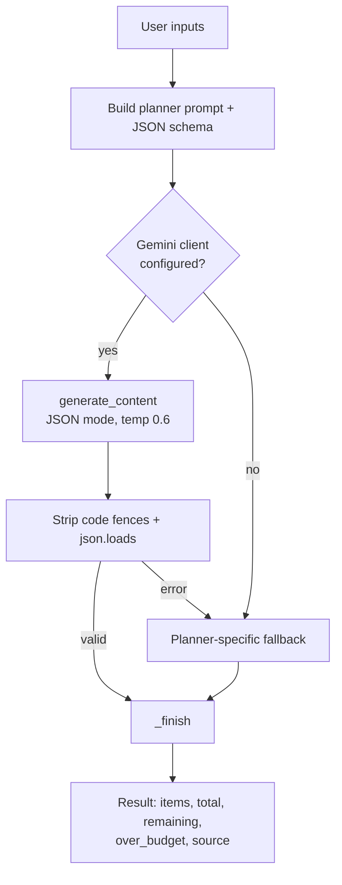

# Phase 5 — AI Recommendation Engine (`gemini_utils.py`)

> Phase 5 of 8 · [Index](README.md) · ← [Phase 4](Phase-4-Data-Layer-and-Authentication.md) · Next → [Phase 6: FastAPI Routes & Integration](Phase-6-FastAPI-Routes-and-Integration.md)

## 1. Objective of this phase
Turn user inputs into reliable, budget-aware, structured recommendations, and guarantee a usable answer even when the AI fails.

## 2. Pipeline


## 3. The JSON contract
Every prompt ends with the same schema instruction, so all three planners return the same shape:
```json
{
  "summary": "2 sentence overview",
  "items": [
    {"category": "...", "name": "specific product/service",
     "platform": "Amazon|Flipkart|IKEA|Swiggy|Zomato|OYO",
     "price": 1234, "reason": "one short sentence"}
  ],
  "tips": ["short money-saving tip"]
}
```
Rules given to the model: prices in INR, **the sum of item prices must not exceed the budget**, and 5–10 items.

## 4. Core functions
| Function | What it does |
|---|---|
| `_ask(prompt, image=None)` | Calls Gemini with JSON response mode and `temperature=0.6`. If an image is given it is sent first as a `Part` with its MIME type. Strips markdown fences and parses JSON |
| `_finish(data, budget, source)` | Rounds prices, skips items with unreadable prices, adds a product `link`, computes `total`, `remaining`, `over_budget`, and records `source` |
| `_run(prompt, budget, fallback, image)` | Tries Gemini; on **any** exception prints a message and uses the planner's fallback |
| `link_for(platform, name)` | Builds a search URL for Amazon, Flipkart, IKEA, Swiggy or OYO. Other platforms (e.g. Zomato) get a Google search link |

## 5. The three planners
### Home — `home_recommendations(budget, style, rooms)`
Prompt lists every room with its lights, fans and dining tables, and asks for IKEA / Amazon / Flipkart options balancing function, style and price.
**Fallback:** per-room defaults (LED ceiling light ₹900, BLDC fan ₹3,000, 4-seater table ₹9,000) multiplied by quantity. If the raw total is above the budget, all prices are scaled down so the total is at most 95% of the budget.

### Party — `party_recommendations(budget, guests, event_type, venue, city)`
Prompt asks for a split across catering, decoration and entertainment (plus stay/venue if needed) from Swiggy, Zomato, OYO and Amazon, tailored to the event type.
**Fallback split:** Catering 50% (Swiggy) · Decoration 20% (Amazon) · Entertainment 15% (Zomato) · Venue/Stay 12% (OYO), which totals 97%.

### Jewelry — `jewelry_recommendations(budget, occasion, style, image=None)`
Adds a note telling the model to match colours and neckline when an outfit image is attached.
**Fallback split:** Necklace 35% · Earrings 25% · Bracelet/Bangles 25% · Ring 10% (95% total).

## 6. Budget handling
The model is *instructed* to stay within budget, but the code does not blindly trust it. `_finish` recalculates the total from the item prices and sets `over_budget`. The results page then shows a warning if the total exceeds the budget.

---
## 7. Output of Phase 5
**Result:** a working engine that always returns a structured plan. Real output from running the fallback path (no API key configured):

```
[party] source=Fallback (offline defaults) items=4 budget=30000 total=29100 remaining=900 over=False
   Catering      | Catering for 40 guests   | Swiggy | 15000 | https://www.swiggy.com/search?query=Catering+for+40+gue...
   Decoration    | Birthday decoration kit  | Amazon |  6000 | https://www.amazon.in/s?k=Birthday+decoration+kit
   Entertainment | DJ / music & games       | Zomato |  4500 | https://www.google.com/search?q=DJ+%2F+music...
   Venue / Stay  | Venue or rooms in Chennai| OYO    |  3600 | https://www.oyorooms.com/search?location=Venue...

[jewelry] source=Fallback (offline defaults) items=4 budget=5000 total=4750 remaining=250 over=False
   Necklace | Traditional necklace for Wedding | Amazon  | 1750
   Earrings | Traditional earrings for Wedding | Flipkart| 1250
   ...
```
Live Gemini responses use the same structure but with specific product names and reasons. Rendered examples are in Phase 7.
